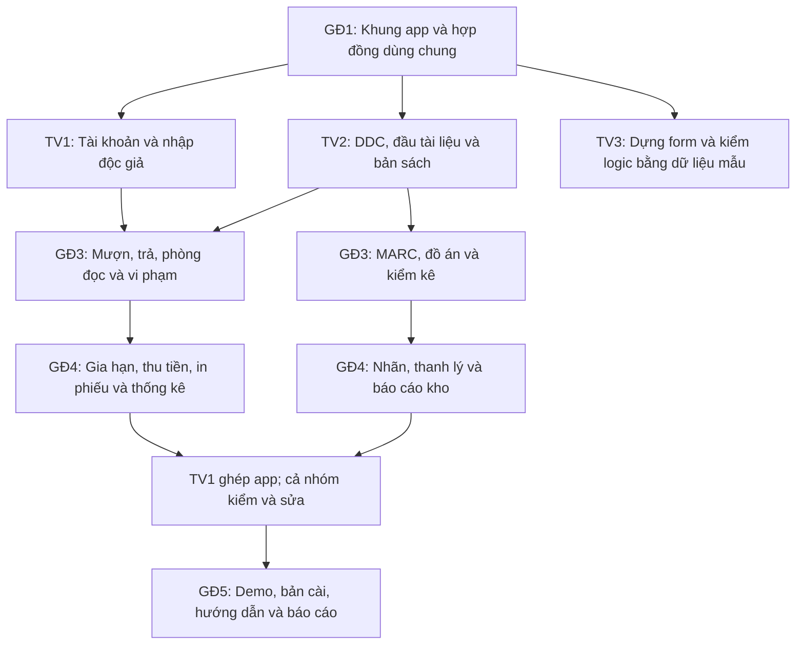

# Kế hoạch triển khai và phân công module — nhóm 3 thành viên

Cập nhật tổ chức mã nguồn ngày **21/11/2026** theo
[kiến trúc server, client và MVC](Kien_truc_Server_Client_MVC.md).
Giao diện MVC ở client gọi TCP Socket/JSON; server thực hiện xử lý và truy cập MySQL.
Phân công mô đun áp dụng cho cả hai phía.

Ngày lập: 19/11/2026. Nền tảng dự kiến: C# WinForms, .NET, MySQL 8.0.21+. Căn cứ: [Cây chức năng](Cay_module_chuc_nang.md), [Workflow](Workflow.md), [Thiết kế CSDL](Thiet_ke_CSDL.md) và cấu hình dự án hiện hành. Đây là kế hoạch triển khai, không phải xác nhận đã lập trình xong.

## 1. Phân công tổng thể

TV1 là Huỳnh Công Thủ (2351220232); TV2 là Võ Ngọc Bình (2351220274), trưởng nhóm; TV3 là Trần Mỹ Nhung (2351220273), lớp 23CT3. Theo dõi tại [bảng Excel hiện hành](../outputs/phan_cong_nhom_3/Theo_doi_cong_viec_den_29_11_2026.xlsx). Mỗi bạn làm giao diện, xử lý nghiệp vụ, truy cập dữ liệu, tự kiểm và viết báo cáo phần mình. Người rà soát hỗ trợ và kiểm phần kết nối, không nhận thay trách nhiệm chính.

| Thành viên | Phụ trách | Module | Điểm dự kiến |
|---|---|---:|---:|
| TV1 | Nền tảng, độc giả, tích hợp | 10 | 30 |
| TV2 | Tài liệu, DDC23/MARC21, kho | 9 | 28 |
| TV3 | Mượn–trả, vi phạm, thu tiền | 10 | 29 |

Điểm là độ lớn tương đối (1–5), không phải ngày công. Phân bổ 30/28/29 điểm để cân bằng cả độ khó và công tích hợp. TV1 chủ trì bản chung; TV2 và TV3 cùng chịu trách nhiệm kiểm thử, sửa lỗi và thuyết trình. Mã module là mã triển khai ổn định, không thay các mã WF và số nhánh chức năng cũ. Không đổi mã khi đổi người nhận.

## 2. Luồng làm việc của nhóm

Hạn nộp đã xác nhận là **29/11/2026**, bắt đầu từ **19/11/2026**. Hoàn thành chức năng trước hết 27/11, kiểm thử và sửa lỗi 28/11, rà soát/demo và nộp 29/11; chưa có giờ nộp. Các nhóm việc có thể chồng lịch. Cột Cần trước trong Excel quy định điều kiện hoàn tất module; được dựng UI và logic độc lập bằng dữ liệu mẫu trước khi module phụ thuộc sẵn sàng.

| Giai đoạn | Mục tiêu | Điều kiện bàn giao |
|---|---|---|
| 1 | Thống nhất nền tảng | Cả nhóm chạy cùng khung app với DB thử; chốt giao diện dịch vụ trước khi tách việc. |
| 2 | Chuẩn bị dữ liệu và quyền | Có độc giả và bản sách mẫu hợp lệ; đăng nhập năm vai trò; TV1/TV2 bàn giao dữ liệu cho TV3. |
| 3 | Hoàn thiện nghiệp vụ chính | Chạy được nhập độc giả → biên mục → mượn → trả → xác định vi phạm; kiểm giao dịch và từ chối sai quyền. |
| 4 | Báo cáo, thiết bị và tích hợp | Chạy được thu tiền/hủy có lưu vết, kiểm kê/thanh lý, báo cáo; menu hợp nhất và bản cài thử. |
| 5 | Kiểm thử và bàn giao | Ba thành viên chạy demo trên máy khác; còn thiếu quy định/thiết bị/API phải ghi rõ trong báo cáo. |

Mỗi module đi qua: nhận việc → chốt đầu vào/đầu ra → lập trình và tự kiểm → PR/người khác rà soát → ghép bản chung → chạy lại luồng liên quan. Nhánh Git gợi ý: feature/TV2-TL-03-marc21. Commit ghi mã module. Không sửa đồng thời form/Designer của nhau; mỗi thay đổi schema/cấu hình phải được cả nhóm xem trước khi ghép. TV1 điều phối file chung, TV2 phụ trách thay đổi cấu trúc CSDL có liên quan catalog/kho, TV3 phụ trách giao dịch lưu thông; mọi thay đổi SQL dùng một bản chuẩn, không tạo ba schema riêng biệt khác cấu trúc.

## 3. Danh sách module

HT: hệ thống; DG: độc giả; TL: tài liệu; KK: kiểm kê/thanh lý; LT: lưu thông; VP: vi phạm/thu tiền; PD: phòng đọc; PH: phản hồi; BC: báo cáo; TC: tích hợp/bàn giao. Có 29 module triển khai; mỗi module gom các thao tác cùng một kết quả nghiệp vụ. Chi tiết bảng, điều kiện nghiệm thu và tiến độ nằm trong Excel.

| Mã | Module | Chủ trì | Rà soát | GĐ | Cần trước |
|---|---|---|---|---:|---|
| HT-01 | Khung ứng dụng và kết nối MySQL | TV1 | TV2 | 1 | Không |
| HT-02 | Đăng nhập, phiên và vai trò | TV1 | TV3 | 2 | HT-01 |
| HT-03 | Cấu hình và nhật ký | TV1 | TV3 | 2 | HT-01 |
| HT-04 | Sao lưu và phục hồi | TV1 | TV2 | 4 | HT-02, HT-03 |
| DG-01 | Khoa, ngành và nhập hồ sơ | TV1 | TV2 | 2 | HT-02, HT-03 |
| DG-02 | Tra cứu và định danh thẻ trường | TV1 | TV3 | 2 | DG-01 |
| DG-03 | Khóa và mở quyền mượn | TV1 | TV3 | 3 | DG-02, HT-03 |
| BC-01 | Thống kê độc giả và nhật ký truy cập | TV1 | TV2 | 4 | DG-01, HT-03 |
| TC-01 | Tích hợp giao diện và bản cài | TV1 | TV2, TV3 | 4 | HT-02 |
| TC-02 | Kiểm thử toàn hệ thống và demo | TV1 | TV2, TV3 | 5 | HT-04, BC-01, TC-01, TL-05, TL-07, KK-02, BC-02, LT-03, VP-03, PD-01, PH-01, BC-03, LT-04 |
| TL-01 | Danh mục DDC23 và xác nhận phân loại | TV2 | TV1 | 2 | HT-02, HT-03 |
| TL-02 | Hồ sơ đầu tài liệu | TV2 | TV3 | 2 | TL-01 |
| TL-03 | Biên mục MARC21 | TV2 | TV1 | 3 | TL-02 |
| TL-04 | Bản sách và dãy kệ/ngăn | TV2 | TV3 | 2 | TL-02 |
| TL-05 | Đồ án, luận văn và tệp đính kèm | TV2 | TV1 | 3 | TL-02, DG-01 |
| TL-07 | In barcode và nhãn gáy | TV2 | TV3 | 4 | TL-04 |
| KK-01 | Kiểm kê kho | TV2 | TV1 | 3 | TL-04, HT-03 |
| KK-02 | Đề nghị và xử lý thanh lý | TV2 | TV3 | 4 | KK-01 |
| BC-02 | Thống kê tài liệu và kho | TV2 | TV1 | 4 | KK-01, TL-03 |
| LT-01 | Mượn sách tại quầy | TV3 | TV1 | 3 | DG-02, DG-03, TL-04, HT-03 |
| LT-02 | Trả sách và tình trạng bản sách | TV3 | TV2 | 3 | LT-01 |
| LT-03 | Gia hạn tại quầy | TV3 | TV1 | 4 | LT-01, HT-03 |
| VP-01 | Quá hạn và bồi thường | TV3 | TV2 | 3 | LT-02, HT-03 |
| VP-02 | Thu tiền và biên lai | TV3 | TV1 | 4 | VP-01 |
| VP-03 | Hủy hiệu lực phiếu phạt | TV3 | TV1 | 4 | VP-02, HT-02 |
| PD-01 | Lượt vào và ra phòng đọc | TV3 | TV1 | 3 | DG-02 |
| PH-01 | Góp ý, đánh giá và đề xuất sách | TV3 | TV2 | 3 | HT-02, TL-02 |
| BC-03 | Thống kê lưu thông, quá hạn và thu tiền | TV3 | TV1 | 4 | VP-02, PD-01, LT-03 |
| LT-04 | In phiếu mượn và biên lai | TV3 | TV2 | 4 | LT-01, VP-02 |

## 4. Ranh giới và bàn giao giữa các bạn

| Bên cung cấp | Bên dùng | Dữ liệu/hợp đồng cần bàn giao |
|---|---|---|
| TV1 — HT-01/02/03 | TV2, TV3 | IP/cổng server và hợp đồng lệnh TCP; truy vấn DB có tham số trên server; phiên IdTaiKhoan/VaiTro/IdDocGia; bộ kiểm quyền; cấu hình và hàm ghi nhật ký. |
| TV1 — DG-01/02/03 | TV2, TV3 | Tìm độc giả theo mã trường; nhóm độc giả/trạng thái/quyền mượn; dữ liệu SV/GV cho đồ án. Chỉ DG-03 thay đổi khóa/mở bằng quyền quản lý. |
| TV2 — TL-02/04 | TV3 | Tra bản sách theo barcode: IdBanTaiLieu, IdDauTaiLieu, trạng thái, giá và vị trí. LT-01/02 được cập nhật trạng thái trong giao dịch, không sửa thông tin biên mục. |
| TV2 — TL-03 | TV2 — BC-02, TV3 — LT-04 | Tên, tác giả, ISBN và dữ liệu MARC cần trình bày; không để các form tự phân tích JSON khác nhau. |
| TV3 — LT/VP | TV1 — DG-03, cả nhóm | Khoản mượn mở, vi phạm chưa giải quyết, khoản đã thanh toán; DG-03 đánh giá điều kiện mở quyền. Không tự mở quyền ngay khi thu tiền. |
| Mỗi thành viên — BC-01/02/03 | TV1 — TC-01 | Màn hình/kết quả báo cáo của mảng mình; TV1 ghép dashboard theo vai trò. Người sở hữu báo cáo chịu trách nhiệm phép đếm và bộ lọc. |
| TV2 — TL-07; TV3 — LT-04 | TV1 — TC-01 | Thành phần in dùng chung, mẫu nhãn/phiếu riêng; máy quét dạng bàn phím qua ô nhập, chưa có thiết bị thì kiểm bằng nhập mã và xem trước. |

Chốt chữ ký các dịch vụ này ở GĐ1 trước khi tách việc. Luồng triển khai là View → Controller client → TCP Socket → Controller server → Service → Repository/Data. Nghiệp vụ mượn/trả/thu tiền phải có một giao dịch DB cho toàn bộ thay đổi liên quan. TV3 chủ trì giao dịch; hàm đọc dữ liệu của TV1/TV2 phải hỗ trợ dùng cùng kết nối/giao dịch khi cần. Dùng trigger/procedure hiện có sau khi rà SQL để tránh cập nhật trạng thái hoặc tính tiền hai lần.

## 5. Phạm vi và các điểm chưa chốt

- Giữ 20 bảng hiện hành, không tách bảng theo số module. Không đặt trước, không cấp thẻ thư viện, không quản lý nhân viên riêng. Hồ sơ độc giả cập nhật qua danh sách trường, không có màn hình sửa tay hoặc xóa độc giả.
- DG-01 triển khai Excel trước bằng một pipeline kiểm tra/nạp chung cho sinh viên và cán bộ/giảng viên. Portal nối vào pipeline đó khi có API/file xuất và được phép truy cập; chưa hứa kết nối thật hoặc tạo nghiệp vụ nhập thứ hai. Cần chốt cách cấp đăng nhập/SSO. Có thể dùng tài khoản demo có mật khẩu băm trong DB thử để kiểm quyền.
- Chỉ Quản lý thư viện được khóa/mở mượn và hủy hiệu lực phiếu phạt. Quản trị không tự được thừa hưởng hai quyền này. Hủy phải giữ dữ liệu và lịch sử; không xóa chứng từ đã thu.
- DDC23 dùng bản in tiếng Việt rút gọn. TV2 phải lưu căn cứ tra cứu; 40 mục và 49 định hướng ngành đang chờ đối chiếu không được tự đánh dấu đã duyệt. Năm/ISBN/số ấn bản trên trang tên còn thiếu.
- MARC21 là profile cục bộ hiện có: một BieuGhiMARC chứa mảng Truong JSON; không xây lại ba bảng hoặc tự thêm nhập/xuất MARCXML/ISO2709 trong đợt này. Kiểm 082 và trạng thái nháp/đã kiểm theo quy tắc hiện hành.
- TV1 thu thập giờ mở/đóng cửa, lịch lễ/Tết và quy tắc cấp đăng nhập. TV3 làm rõ ngày bắt đầu/kết thúc tính phạt, số lần/thời gian gia hạn, xử lý khóa quyền khi còn bồi thường và thẩm quyền định giá/đình chỉ. TV2 làm rõ người duyệt thanh lý, cách xử lý sách đang mượn khi kiểm kê. Trước khi chốt, cấu hình thiếu phải được thông báo; không tự gán quy định.
- Vị trí chỉ dãy kệ/ngăn. Kiểm kê dùng KiemKe/ChiTietKiemKe; người kiểm lưu trên chi tiết. Không tự ghi nhận mất sách do kiểm kê thiếu rồi thanh lý luôn.

## 6. Nghiệm thu xuyên module và demo

1. Nhập danh sách có dòng đúng, thiếu trường, trùng mã; nạp lại không tạo độc giả trùng. Tìm bằng thẻ trường và kiểm tra đúng năm vai trò. Chỉ Biên mục khóa/mở đăng nhập độc giả; các vai trò khác bị từ chối; không thay quyền mượn.
2. Tạo đầu tài liệu và MARC, đối chiếu DDC, tạo nhiều bản sách khác barcode; tìm được đúng tác giả/vị trí/tình trạng. Sửa MARC phải mất trạng thái đã kiểm khi quy tắc yêu cầu.
3. SV mượn tối đa 2 đầu/10 ngày; CB/GV 3 đầu/15 ngày. Thử trùng nhan đề, vượt mức, quyền bị khóa, 15 phút cuối và hai máy cùng mượn một bản. Không có phiếu dở dang khi một bước lỗi.
4. Trả thường, trả một phần, trả lặp; quá hạn SV có ngày miễn phạt; CB/GV sinh thông báo đơn vị. Khi lịch lễ chưa xác nhận, hệ thống không tự chốt số tiền theo toàn bộ ngày.
5. Mất/hỏng: 2 lần giá, sách thay thế cộng 20.000đ, hoặc chi phí trang theo quyết định. Thu đủ, chặn thu trùng; thủ thư bị từ chối hủy phiếu/khóa mở; quản lý được thao tác và có nhật ký. Hủy khoản đã thu giữ số tiền chứng từ.
6. Gia hạn hợp lệ và bị từ chối; nhập/ra phòng đọc; kiểm kê thiếu/thừa/sai vị trí; thanh lý theo quyết định; số báo cáo khớp chứng từ và bộ lọc.
7. Chạy client trên máy khác gọi server kết nối DB thử, thử backup/restore trên DB riêng; in xem trước và ghi rõ thiết bị chưa có. Mỗi bạn trình bày phần mình và bàn giao hướng dẫn.

Chỉ chuyển trạng thái Hoàn thành khi có kết quả tự kiểm, người khác rà soát và chạy luồng liên quan. TC-02 là đầu mối tổng hợp, cả ba cùng chạy kiểm thử và sửa lỗi. Không dùng dữ liệu thử để ghi đè DB đang dùng.

## 7. Lịch theo dõi đến hạn nộp 29/11/2026

Các mốc dưới đây là dự kiến. Chưa cập nhật ngày thực hiện hay phần trăm thực tế. Mốc cùng ngày cần bàn giao theo thứ tự phụ thuộc. Tích hợp TC-01 thực hiện dần từ 20/11.

| Mã | Công việc | Người đảm nhiệm | Bắt đầu | Hạn xong | Trạng thái |
|---|---|---|---|---|---|
| HT-01 | Khung ứng dụng và kết nối MySQL | Huỳnh Công Thủ | 19/11/2026 | 19/11/2026 | Chưa cập nhật |
| HT-02 | Đăng nhập, phiên và vai trò | Huỳnh Công Thủ | 20/11/2026 | 20/11/2026 | Chưa cập nhật |
| HT-03 | Cấu hình và nhật ký | Huỳnh Công Thủ | 20/11/2026 | 20/11/2026 | Chưa cập nhật |
| HT-04 | Sao lưu và phục hồi | Huỳnh Công Thủ | 26/11/2026 | 26/11/2026 | Chưa cập nhật |
| DG-01 | Khoa, ngành và nhập hồ sơ | Huỳnh Công Thủ | 21/11/2026 | 21/11/2026 | Chưa cập nhật |
| DG-02 | Tra cứu và định danh thẻ trường | Huỳnh Công Thủ | 22/11/2026 | 22/11/2026 | Chưa cập nhật |
| DG-03 | Khóa và mở quyền mượn | Huỳnh Công Thủ | 23/11/2026 | 23/11/2026 | Chưa cập nhật |
| BC-01 | Thống kê độc giả và nhật ký truy cập | Huỳnh Công Thủ | 26/11/2026 | 26/11/2026 | Chưa cập nhật |
| TC-01 | Tích hợp giao diện và bản cài | Huỳnh Công Thủ | 20/11/2026 | 27/11/2026 | Chưa cập nhật |
| TC-02 | Kiểm thử toàn hệ thống và demo | Huỳnh Công Thủ | 28/11/2026 | 29/11/2026 | Chưa cập nhật |
| TL-01 | Danh mục DDC23 và xác nhận phân loại | Võ Ngọc Bình | 20/11/2026 | 20/11/2026 | Chưa cập nhật |
| TL-02 | Hồ sơ đầu tài liệu | Võ Ngọc Bình | 21/11/2026 | 21/11/2026 | Chưa cập nhật |
| TL-03 | Biên mục MARC21 | Võ Ngọc Bình | 22/11/2026 | 23/11/2026 | Chưa cập nhật |
| TL-04 | Bản sách và dãy kệ/ngăn | Võ Ngọc Bình | 22/11/2026 | 22/11/2026 | Chưa cập nhật |
| TL-05 | Đồ án, luận văn và tệp đính kèm | Võ Ngọc Bình | 24/11/2026 | 24/11/2026 | Chưa cập nhật |
| TL-07 | In barcode và nhãn gáy | Võ Ngọc Bình | 26/11/2026 | 26/11/2026 | Chưa cập nhật |
| KK-01 | Kiểm kê kho | Võ Ngọc Bình | 25/11/2026 | 25/11/2026 | Chưa cập nhật |
| KK-02 | Đề nghị và xử lý thanh lý | Võ Ngọc Bình | 26/11/2026 | 26/11/2026 | Chưa cập nhật |
| BC-02 | Thống kê tài liệu và kho | Võ Ngọc Bình | 26/11/2026 | 27/11/2026 | Chưa cập nhật |
| LT-01 | Mượn sách tại quầy | Trần Mỹ Nhung | 23/11/2026 | 24/11/2026 | Chưa cập nhật |
| LT-02 | Trả sách và tình trạng bản sách | Trần Mỹ Nhung | 25/11/2026 | 25/11/2026 | Chưa cập nhật |
| LT-03 | Gia hạn tại quầy | Trần Mỹ Nhung | 26/11/2026 | 26/11/2026 | Chưa cập nhật |
| VP-01 | Quá hạn và bồi thường | Trần Mỹ Nhung | 25/11/2026 | 26/11/2026 | Chưa cập nhật |
| VP-02 | Thu tiền và biên lai | Trần Mỹ Nhung | 26/11/2026 | 27/11/2026 | Chưa cập nhật |
| VP-03 | Hủy hiệu lực phiếu phạt | Trần Mỹ Nhung | 27/11/2026 | 27/11/2026 | Chưa cập nhật |
| PD-01 | Lượt vào và ra phòng đọc | Trần Mỹ Nhung | 23/11/2026 | 23/11/2026 | Chưa cập nhật |
| PH-01 | Góp ý, đánh giá và đề xuất sách | Trần Mỹ Nhung | 24/11/2026 | 24/11/2026 | Chưa cập nhật |
| BC-03 | Thống kê lưu thông, quá hạn và thu tiền | Trần Mỹ Nhung | 27/11/2026 | 27/11/2026 | Chưa cập nhật |
| LT-04 | In phiếu mượn và biên lai | Trần Mỹ Nhung | 27/11/2026 | 27/11/2026 | Chưa cập nhật |

## Quyền khóa tài khoản và quyền mượn

- **Biên mục (BIEN_MUC):** duy nhất được khóa/mở tài khoản đăng nhập của độc giả (`TaiKhoan.DangHoatDong`), chỉ áp dụng tài khoản có vai trò `DOC_GIA` và liên kết hồ sơ độc giả. Bắt buộc lý do và nhật ký.
- **Quản lý thư viện (QUAN_LY_THU_VIEN):** khóa/mở quyền mượn (`DocGia.DuocMuon`, `KhoaDen`, `LyDoKhoa`) và hủy hiệu lực phiếu phạt.
- Quản trị, Nhung thư và Độc giả không có quyền khóa/mở đăng nhập độc giả. Mở đăng nhập không mở quyền mượn; mở quyền mượn không mở đăng nhập. Tại quầy vẫn kiểm quyền mượn riêng.
- HT-02 do TV1 triển khai màn hình và kiểm quyền khóa/mở đăng nhập; người sử dụng nghiệp vụ là Biên mục. Vai trò cố định gồm QUAN_TRI, QUAN_LY_THU_VIEN, BIEN_MUC, THU_THU, DOC_GIA.
