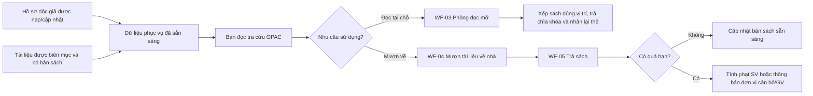
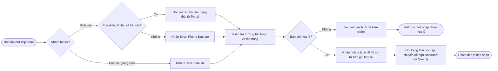
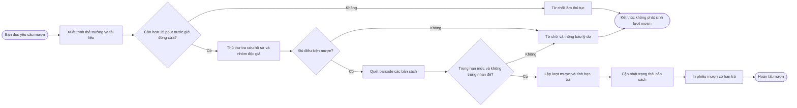
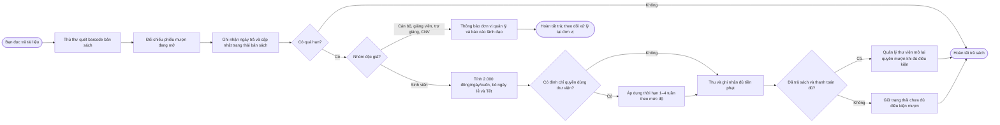
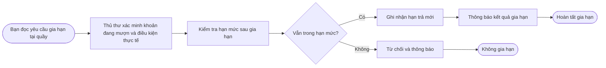
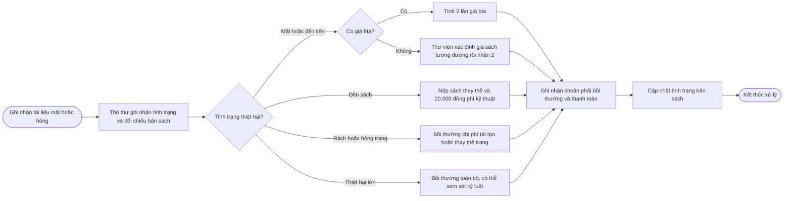
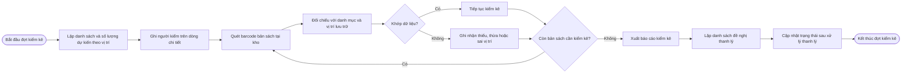

# Phân tích và thiết kế workflow – HTTT Quản lý Thư viện DAU

## 1. Phạm vi và căn cứ

Tài liệu dựa trên cây chức năng, quy định thư viện và phạm vi người dùng đã chốt. Bản ngày 09/11/2026 dùng MySQL 8.0.21+, DDC23 bản in tiếng Việt rút gọn và MARC21. [Cây chức năng](Cay_module_chuc_nang.md) · [Thiết kế CSDL](Thiet_ke_CSDL.md)

Dự án đang ở giai đoạn đầu. Ngày 19/11/2026 đã tạo khung WinForms .NET 10 và lớp kiểm tra kết nối MySQL; chưa lập trình các module nghiệp vụ. Các sơ đồ mô tả **thiết kế nghiệp vụ dự kiến**, không khẳng định các quy trình đã hoạt động hoặc Portal DAU đã có API/kết nối kỹ thuật.

### Tác nhân và nguồn dữ liệu

- **Bạn đọc:** sinh viên; cán bộ, giảng viên, trợ giảng, CNV.
- **Thủ thư:** xác minh hồ sơ, ghi nhận mượn/trả, gia hạn và xử lý vi phạm tại quầy.
- **Biên mục:** lập hồ sơ tài liệu, bản sách, mã ĐKCB và vị trí kho.
- **Quản trị hệ thống:** gán một trong bốn vai trò cố định cho tài khoản; không tạo/sửa/xóa riêng tài khoản nhân viên.
- **Nguồn sinh viên:** một quy trình tiếp nhận danh sách gồm mã số, họ tên, trạng thái học tập; ưu tiên Portal DAU nếu đủ trường dữ liệu và có phương thức kết nối, Excel Phòng Đào tạo là phương án nhập đầu/dự phòng. Không nạp lặp song song cùng một danh sách.
- **Nguồn cán bộ/giảng viên:** Excel theo điều chỉnh đã thống nhất.
- **Định danh:** dùng thẻ trường; thư viện không phát hành thẻ thư viện. Barcode dùng để nhận diện bản sách.

Phạm vi hiện hành dùng 20 bảng. Kiểm kê dùng `KiemKe` và `ChiTietKiemKe`. Vị trí kho gồm dãy kệ và ngăn. Thủ thư kiêm biên mục, mỗi tài khoản có một vai trò cố định. Các quy trình giữ mã WF hiện có để khớp tài liệu nghiệp vụ.

## 2. Danh mục workflow

| Mã | Quy trình | Mức căn cứ | Kết quả chính |
|---|---|---|---|
| WF-01 | Tiếp nhận/cập nhật hồ sơ độc giả | Một phần quy định nguồn; cần xác nhận kết nối Portal | Hồ sơ được nhập/cập nhật; cách cấp đăng nhập chưa chốt |
| WF-02 | Biên mục tài liệu và tạo bản sách | Theo cây chức năng; thao tác chi tiết còn cần xác nhận | Bản sách có ĐKCB, barcode, vị trí và thông tin tra cứu |
| WF-03 | Sử dụng phòng đọc mở | Theo quy định thư viện | Bạn đọc hoàn tất lượt đọc, trả chìa khóa và nhận lại thẻ |
| WF-04 | Mượn tài liệu về nhà | Theo quy định thư viện | Phiếu mượn, hạn trả và trạng thái bản sách được ghi nhận |
| WF-05 | Trả sách và xử lý quá hạn | Theo quy định thư viện | Trả sách được ghi nhận; khoản phạt hoặc thông báo được tạo khi cần |
| WF-06 | Gia hạn mượn | Điều kiện có trong quy định; thời hạn gia hạn chưa nêu | Hạn trả được cập nhật hoặc yêu cầu bị từ chối |
| WF-07 | Xử lý tài liệu mất/hỏng | Theo quy định thư viện | Bồi thường được xác định và tình trạng tài liệu được ghi nhận |
| WF-09 | Kiểm kê và thanh lý | Có các bước chức năng mức cao; vai trò duyệt còn thiếu | Sai lệch được ghi nhận; quyết định thanh lý và tình trạng được cập nhật |

## 3. Sơ đồ workflow

### WF-00 — Luồng phục vụ bạn đọc tổng quan

Hồ sơ độc giả và danh mục tài liệu được chuẩn bị độc lập trước khi phục vụ. WF-00 chỉ cho thấy hai hướng sử dụng chính; gia hạn và mất/hỏng được tách thành workflow riêng bên dưới.

### WF-01 — Tiếp nhận/cập nhật hồ sơ độc giả

**Luồng chính:** dữ liệu sinh viên từ Portal hoặc Excel đi vào cùng một bước kiểm tra và cập nhật hồ sơ. Không xử lý hai nguồn như hai nghiệp vụ độc lập. Nếu Portal không cung cấp đủ dữ liệu hoặc chưa có kết nối, dùng Excel theo quy trình dự phòng. Với cán bộ/giảng viên, dùng Excel.

### WF-02 — Biên mục tài liệu và tạo bản sách

```mermaid
flowchart LR
    start(["Tiếp nhận tài liệu"]) --> search["Tra cứu hồ sơ thư mục hiện có"]
    search --> found{"Đã có hồ sơ phù hợp?"}
    found -->|"Có"| select["Chọn hồ sơ thư mục"]
    found -->|"Không"| createRecord["Tạo hồ sơ thư mục mới"]
    createRecord --> classify["Lưu mô tả MARC21 gồm tác giả và NXB"]
    classify --> ddc["Tra DDC23 bản in, lưu nguồn và thông tin xác nhận"]
    ddc --> marc["Kiểm tra cấu trúc MARC và đối chiếu trường 082"]
    select --> itemType{"Loại tài liệu?"}
    marc --> itemType
    itemType -->|"Sách"| bookData["Hoàn thiện dữ liệu sách"]
    itemType -->|"Đồ án, luận văn"| thesisData["Nhập đề tài, giảng viên, sinh viên, khóa và tệp"]
    bookData --> copy["Tạo bản sách vật lý"]
    thesisData --> copy
    copy --> id["Phát sinh ĐKCB và barcode duy nhất"]
    id --> location["Gán vị trí và trạng thái bản sách"]
    location --> labels["In nhãn mã vạch và nhãn gáy"]
    labels --> available(["Sẵn sàng tra cứu theo tình trạng bản sách"])
```

Khi lưu biên mục, mảng `BieuGhiMARC.Truong` chứa các trường, chỉ thị và trường con theo thứ tự. Khi đính kèm bản vẽ hoặc luận văn, `DauTaiLieu.DanhSachTep` chứa tên và đường dẫn của từng tệp. Kiểm tra MARC hiện áp dụng hồ sơ cấu trúc cục bộ. Giao diện và bộ đọc, xuất MARCXML/ISO2709 thuộc bước triển khai ứng dụng. Cần chốt quy tắc nhận diện trùng và thông tin bắt buộc theo loại tài liệu.

### WF-03 — Sử dụng phòng đọc mở

```mermaid
flowchart LR
    start(["Bạn đọc đến thư viện"]) --> locker["Gửi tư trang vào tủ, khóa tủ và giữ chìa"]
    locker --> card["Xuất trình thẻ Sinh viên tại quầy"]
    card --> hold["Thủ thư giữ thẻ trong thời gian đọc"]
    hold --> visit["Ghi nhận lượt vào phòng đọc"]
    visit --> search["Tra cứu OPAC, ghi khung phân loại và ĐKCB"]
    search --> take["Lấy tối đa 02 cuốn mỗi lượt"]
    take --> read["Sử dụng tài liệu, giữ trật tự và vệ sinh"]
    read --> reshelve["Tự xếp sách lại đúng vị trí cũ"]
    reshelve --> exit["Trả chìa khóa tủ tại quầy"]
    exit --> returnCard["Nhận lại thẻ Sinh viên"]
    returnCard --> finish(["Kết thúc lượt đọc"])
```

**Quy tắc thể hiện:** bạn đọc tự bảo quản tiền, giấy tờ và đồ giá trị; chỉ mang vở/dụng cụ học tập vào phòng; không mang quá 02 cuốn mỗi lượt.

### WF-04 — Mượn tài liệu về nhà

**Hạn mức:** cán bộ/giảng viên/trợ giảng/CNV tối đa 03 đầu sách trong 15 ngày; sinh viên tối đa 02 đầu sách trong 10 ngày. Không mượn hai cuốn cùng nhan đề. Hệ thống cần xét số đầu sách đang mượn cùng yêu cầu hiện tại.

### WF-05 — Trả sách và xử lý quá hạn

**Cần chốt:** thời điểm bắt đầu/kết thúc tính phạt và danh mục ngày lễ/Tết phải lấy từ lịch nào; ai quyết định đình chỉ; quy trình mở lại quyền mượn cho cán bộ/giảng viên sau khi đơn vị xử lý chưa được mô tả. Không gán khoản phạt tiền cho nhóm cán bộ/giảng viên vì quy định không nêu mức phạt tiền cho nhóm này.

### WF-06 — Gia hạn mượn

**Cần chốt:** mỗi lần được gia hạn bao lâu, tối đa bao nhiêu lần, thời điểm muộn nhất được gửi yêu cầu và cách tính hạn trả mới. Dự án không có cơ chế đăng ký trước; thủ thư đối chiếu điều kiện thực tế tại quầy, không dùng hàng đợi hoặc phiếu giữ chỗ.

### WF-07 — Xử lý tài liệu mất hoặc hỏng

**Cần chốt:** thẩm quyền xác định giá sách tương đương và chi phí thay trang; chứng từ cần lưu; tình trạng bản sách sau khi bồi thường. Quy định chưa nói rõ việc khóa quyền mượn khi còn khoản bồi thường, vì vậy không tự thêm nhánh khóa/mở quyền vào workflow này.

### WF-09 — Kiểm kê và thanh lý (khung sơ bộ)

Đây là khung từ cây chức năng. **Chưa chốt:** vai trò xác nhận sai lệch, người có thẩm quyền duyệt thanh lý, bộ hồ sơ/chứng từ và cách xử lý bản đang cho mượn.

## 4. Quy tắc nghiệp vụ xuyên workflow

1. Không cấp thẻ thư viện; dùng thẻ trường để định danh. Mượn sách về nhà phải xuất trình thẻ trường cùng tài liệu.
2. Phòng đọc mở tối đa 02 cuốn mỗi lượt; bạn đọc tự xếp sách lại đúng vị trí.
3. Mượn về: cán bộ/giảng viên/trợ giảng/CNV tối đa 03 đầu sách/15 ngày; sinh viên tối đa 02 đầu sách/10 ngày; không mượn hai cuốn cùng nhan đề.
4. Không xử lý mượn trong 15 phút trước giờ đóng cửa.
5. Chỉ gia hạn nếu không có bạn đọc khác đăng ký và sau gia hạn vẫn trong hạn mức.
6. Sinh viên trả trễ: 2.000 đồng/ngày/cuốn, không tính ngày lễ/Tết; có thể đình chỉ 1–4 tuần. Cán bộ/giảng viên/trợ giảng/CNV: thông báo đơn vị quản lý và báo cáo lãnh đạo trường để xem xét.
7. Làm mất/hỏng: đền tiền gấp 2 giá bìa/giá tương đương; đền bằng sách cộng 20.000 đồng phí kỹ thuật; hỏng trang theo chi phí tái tạo/thay thế; thiệt hại lớn bồi thường toàn bộ và có thể bị kỷ luật.

## 5. Điểm cần thống nhất trước khi thiết kế chi tiết

1. Portal DAU có thể cung cấp và cho phép truy cập những trường dữ liệu nào; có cơ chế đồng bộ hay chỉ xuất file? Nếu không đủ trường/kết nối, Excel là nguồn chính chứ không phải phương án dự phòng.
2. Cấu trúc file Excel, cách phân biệt thêm mới/cập nhật/ngừng học, xử lý mã số trùng và lưu lỗi nhập.
3. Danh mục ngày lễ/Tết, giờ đóng cửa theo ngày, cách tính ngày quá hạn.
4. Định nghĩa “đầu sách”, “cùng nhan đề”, quy tắc cho các phiên bản/tập khác nhau.
5. Thời hạn, số lần gia hạn và kênh thông báo kết quả tại quầy.
6. Đã chốt chỉ Quản lý thư viện khóa/mở quyền mượn và hủy hiệu lực phiếu phạt; không xóa độc giả. Còn cần chốt thẩm quyền xác định giá tương đương, mức đình chỉ cụ thể và duyệt thanh lý.
7. Cách phục hồi quyền mượn của cán bộ/giảng viên sau khi đơn vị xử lý; quy tắc chặn quyền khi còn bồi thường.

## 6. Ràng buộc thiết kế và nghiệm thu workflow

- **Nền tảng hiện tại:** C# .NET/Windows Forms, MySQL 8.0, mô hình Client–Server. Schema MySQL đã có tại `../csdl/01_Tao_CSDL.sql`; tài liệu này mô tả luồng nghiệp vụ dự kiến, chưa phải code/API đã triển khai.
- Mọi workflow mượn/trả cần cập nhật phiếu và trạng thái bản sách nhất quán; không để một phần giao dịch thành công nếu phần còn lại lỗi.
- Mỗi nhánh từ chối cần chỉ rõ điều kiện, lý do trả cho người dùng và trạng thái dữ liệu sau khi từ chối.
- Dữ liệu tiền phạt/bồi thường phải thể hiện số tiền, căn cứ tính, ngày thu và trạng thái thanh toán; các trường lưu cụ thể cần xác nhận khi thiết kế CSDL.
- Nghiệm thu workflow bằng các nhánh tối thiểu: hợp lệ, thiếu/trùng dữ liệu, vượt hạn mức, đúng/sát giờ đóng cửa, có/không quá hạn, đã/chưa thanh toán.
- Workflow WF-09 chỉ là khung nghiệp vụ cho tới khi các điểm cần thống nhất ở mục 5 được xác nhận.
